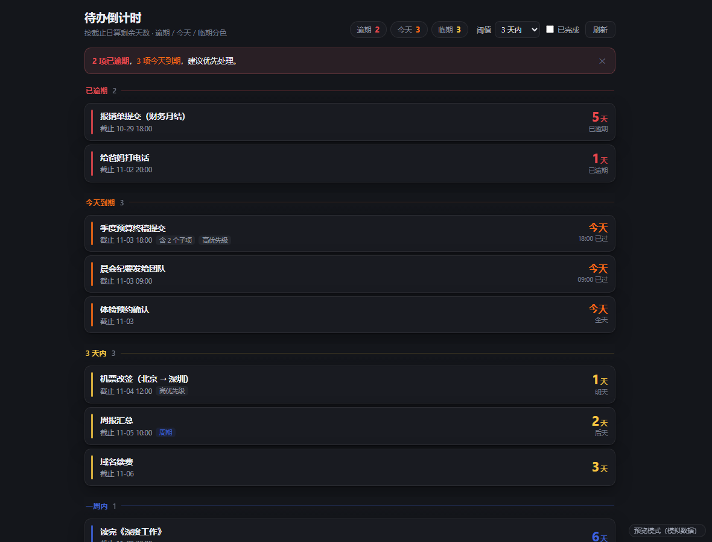

# 待办倒计时 · x-hub 扩展

给 [x-hub](https://github.com/dckxx/x-hub) 的待办加一层**倒计时**：按截止日期算剩余天数，
逾期 / 今天 / 临期分色，临期自动提醒，并带一张工作台卡片。

> 非官方扩展。只读 `todos`，不修改 x-hub 本体、不写数据库，卸载即还原。

宿主项目：[**dckxx/x-hub**](https://github.com/dckxx/x-hub) —— 本地优先的个人桌面效率工作台，Tauri 2 + Vue 3 + TypeScript + Rust，数据全部本地存储。
本扩展遵循它的扩展规范（`manifest.json` + `window.xhub` 桥），只申请 `data:read` 与 `notify` 两项权限。



| 工作台卡片 · 标准 | 工作台卡片 · 紧凑 |
|---|---|
|  |  |

---

## 功能

- **剩余天数**：按自然日计算 `d = 截止日 − 今天`，显示「今天 / 明天 / 后天 / N 天 / 逾期 N 天」。
- **状态分档**：逾期（红）、今天（橙）、临期（琥珀）、一周内（蓝）、更远（灰）、未排期、已完成。
- **临期提醒**：进入逾期 / 今天 / 临期时推送通知，同一待办同一阶段 12 小时冷却、单次最多 3 条；
  没给通知权限时降级为页面内提示条。
- **工作台卡片**：紧凑（2×2）与标准（4×3）两种形态，随格子高度自适应。
- **分组与筛选**：逾期 → 今天 → N 天内 → 一周内 → 更远 → 未排期 → 已完成；顶部胶囊一键筛选。
- **只读**：仅调用 `data.todos.list`，不写入任何待办；唯一的持久化是提醒去重表。

## 安装

1. 打开 x-hub → **扩展中心** → **我的扩展** → **添加源码目录**。
2. 选中本仓库根目录（必须包含 `manifest.json` 这一层）。
3. 加进来即加载：
   - 扩展列表点「待办倒计时」→ 打开主视图；
   - 工作台 → 自定义布局 → 模块库 → 拖入「待办倒计时」，可选 **紧凑（2×2）** 或 **标准（4×3）**。

> 首次加载会申请 `data:read`（读待办）与 `notify`（临期通知）。拒绝 `notify` 也能用。

## 本地预览（不装 x-hub）

直接打开 `devharness/host.html`。它用 `shared/mock-bridge.js` 顶替宿主的 `window.xhub`，
可以切形态 / 主题 / 场景，还能「时间旅行」（把 `now` 往后推 N 天）观察逾期与跨天换日。

也可以单独打开：

```
view/index.html?mock=1&theme=dark
module/index.html?mock=1&theme=dark&xhub-variant=compact
```

`file://` 下自动启用模拟数据；真宿主里宿主已注入 `window.xhub`，mock 不会生效。

## 数据接入

卡片数据来自宿主接口 `xhub.data.todos.list()`，经 `module/data.js` 归一后进入计算层：
单位/类型/缺字段/包装格式都有兼容，加载、空、错误三态齐全，错误可重试。
字段映射与后端差异清单见 [数据接入说明](docs/数据适配.md)。

## 测试

```bash
node tests/countdown.test.mjs   # 日期与状态：95 项
node tests/adapter.test.mjs     # 字段归一与容错：46 项
```

95 条断言，覆盖今天 / 明天 / 逾期 / 跨年 / 闰年 / 夏令时 / 日界线 / 脏数据 / 子待办折叠 / 排序 / 统计 / 提醒去重 / 跨天定时器。

夏令时相关用例建议换时区再跑一遍（Windows 下用 PowerShell 设 `TZ` 才生效）：

```powershell
$env:TZ='America/New_York'; node tests\countdown.test.mjs
$env:TZ='Europe/Berlin';    node tests\countdown.test.mjs
```

## 目录结构

```
manifest.json            扩展声明：形态、入口、权限、默认配置
icon.svg                 图标（自带配色，遵循宿主  渲染约定）
shared/countdown.js      纯逻辑：日差、状态、排序、分组、统计、提醒挑选（无 DOM）
shared/theme.css         --xhub-* 主题令牌 + 深浅兜底
shared/mock-bridge.js    预览用模拟宿主（仅 file:// 或 ?mock=1 生效）
module/data.js           数据适配层：取数、超时、错误归一、字段归一
view/                    主视图：分组倒计时列表
module/                  工作台卡片：compact / standard 共用一份 HTML
devharness/host.html     预览台
tests/countdown.test.mjs 单元测试
docs/待办倒计时-设计与实现.md   设计说明：数据结构、计算规则、边界、更新逻辑
docs/数据适配.md         卡片数据契约：字段映射、后端差异、状态处理
```

## 配置

默认值写在 `manifest.json` 的 `config`，用户在扩展设置里改，宿主写入扩展目录的 `.config.json`（已在 `.gitignore` 中忽略）。

| 键 | 默认 | 说明 |
|---|---|---|
| `warnDays` | `3` | 临期阈值（天），可选 1 / 3 / 7 / 14 |
| `dayStartHour` | `0` | 业务日分界，设 `4` 表示凌晨 4 点前算前一天 |
| `showCompleted` | `false` | 列表是否显示已完成待办 |
| `notifyEnabled` | `true` | 是否推送临期通知 |
| `notifyCooldownHours` | `12` | 同一待办同一阶段的提醒冷却 |
| `maxNotifyPerRun` | `3` | 单次最多推送几条 |

主视图右上角的「阈值 / 已完成」会直接写回这些配置。

## 计算规则要点

- `d = 业务日(截止) − 业务日(现在)`，用本地日历字段求整数天，避免夏令时与「23:59 差一分钟」误差；
- `d = 0` 即今天（**含当天**），`d + 1` 是「含当天还剩几天」；
- 只有 `d < 0` 才算逾期；当天已过具体时刻只在徽标上标「已过」，不染色；
- 完整规则、状态机、24 条边界情况见 [设计说明](docs/待办倒计时-设计与实现.md)。

## 兼容性

- 宿主项目：[dckxx/x-hub](https://github.com/dckxx/x-hub)
- 目标版本：**x-hub 0.9.1**（Tauri 2 / Vue 3 / 桥 API `data.todos.list`）。
- 依赖宿主能力：`data.todos.list`；提醒依赖 `notify` 权限。
- 更早版本未验证；宿主若调整桥 API，`requires` 会在扩展中心标「缺能力」。
- 想让它变成内置功能（列表行内倒计时）可以改宿主源码，改动面很小，见[设计说明附录](docs/待办倒计时-设计与实现.md#附录合入内置待办列表改宿主源码)。

## 许可

暂未指定。如需开源授权，建议补充 `LICENSE`（MIT 或 Apache-2.0）。
